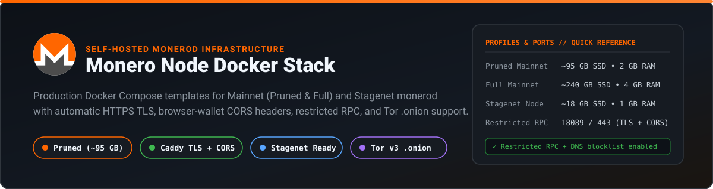
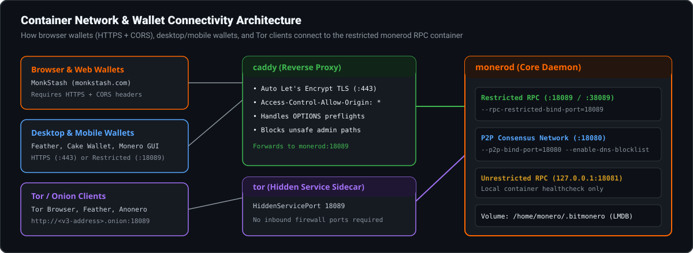

<p align="center">
  
</p>

# Monero Node Docker Stack

Ready-to-run Docker Compose configurations for self-hosting a Monero node (`monerod`) on **Mainnet** (pruned or full archival) and **Stagenet**, paired with a **Caddy reverse proxy** for automatic Let's Encrypt HTTPS, browser-wallet CORS headers, restricted RPC hardening, and optional **Tor v3 `.onion`** hidden service support.

---

## Why Run Your Own Node?

When you connect a wallet to a third-party public node, that node never sees your private keys or spend amounts, but it can observe your IP address, the block heights your wallet requests, and the transactions you broadcast. Running your own `monerod` node keeps your network metadata on your own hardware while validating every block and transaction from genesis.

For a background explainer on how nodes work and the difference between pruned and full storage, see:
- [How to Run a Monero Node](https://monkstash.com/run-a-monero-node)
- [Monero Pruned Node Explained](https://monkstash.com/monero-pruned-node)
- [How Monero Remote Nodes Work](https://monkstash.com/monero-remote-node)

---

## Container & Network Architecture

<p align="center">
  
</p>

### Why Caddy + CORS Is Included by Default

Browser-based Monero wallets (such as [MonkStash](https://monkstash.com)) run inside an `https://` browser context. Modern browsers enforce two rules when a web wallet connects directly to your remote node:

1. **HTTPS Required (Mixed Content):** An `https://` page cannot make requests to a plain `http://` IP address on another machine (except `http://127.0.0.1` loopback or `http://*.onion` inside Tor Browser).
2. **CORS Preflight (`OPTIONS`):** The node must return `Access-Control-Allow-Origin` and handle `OPTIONS` preflight requests.

The included [`config/Caddyfile`](config/Caddyfile) and [`config/monerod-pruned.conf`](config/monerod-pruned.conf) configure both out of the box while blocking administrative daemon endpoints (`/stop_daemon`, `/start_mining`, etc.) at the proxy edge.

---

## Hardware Requirements by Profile

| Profile | Compose File | Disk (SSD Required) | RAM | P2P Port | Restricted RPC Port | Best For |
| :--- | :--- | :--- | :--- | :--- | :--- | :--- |
| **Mainnet Pruned** *(Default)* | [`docker-compose.yml`](docker-compose.yml) | **~95 GB** | 2 GB | `18080` | `18089` / `443` | Personal wallets, [MonkStash](https://monkstash.com), Feather, Cake Wallet, merchant checkouts |
| **Mainnet Full (Archival)** | [`docker-compose.full.yml`](docker-compose.full.yml) | **~240+ GB** | 4 GB | `18080` | `18089` / `443` | Archival nodes, P2Pool mining (ZMQ `18083`/`18084`), block explorers |
| **Stagenet Pruned** | [`docker-compose.stagenet.yml`](docker-compose.stagenet.yml) | **~18 GB** | 1 GB | `38080` | `38089` | Testing payment gateways, webhooks, and wallet flows without real XMR |
| **Tor v3 `.onion` Overlay** | [`docker-compose.tor.yml`](docker-compose.tor.yml) | +10 MB | +64 MB | — | `.onion:18089` | Connecting over Tor without opening inbound router ports |

> **Important:** Always store the `/home/monero/.bitmonero` LMDB volume on an **SSD or NVMe drive**. Syncing Monero on a spinning HDD takes weeks and frequently stalls during batch verification.

---

## Quick Start

### 1. Copy the environment file

```bash
cp .env.example .env
```

Edit `.env`:
- If you have a domain pointing to your server (e.g. `node.example.com`), set `MONERO_DOMAIN=node.example.com`. Caddy will automatically obtain and renew a Let's Encrypt TLS certificate on port `443`.
- If you are running on a local machine or LAN without a domain, leave `MONERO_DOMAIN=localhost` and set `RPC_BIND_IP=0.0.0.0` if you want other devices on your LAN to reach port `18089`.

### 2. Start a Pruned Mainnet Node (Default)

```bash
docker compose up -d
```

Follow the initial blockchain sync logs:

```bash
docker compose logs -f monerod
```

### 3. Alternative Profiles

**Run an unpruned Full Mainnet node (with local ZMQ for P2Pool):**

```bash
docker compose -f docker-compose.full.yml up -d
```

**Run a Stagenet node (for development & checkout testing):**

```bash
docker compose -f docker-compose.stagenet.yml up -d
```

**Add a Tor v3 `.onion` hidden service to your Mainnet node:**

```bash
docker compose -f docker-compose.yml -f docker-compose.tor.yml up -d
```

To print your generated `.onion` address:

```bash
docker exec monerod-tor-onion cat /var/lib/tor/hidden_service/monerod/hostname
```

---

## Checking Node Health & Sync Progress

Use the included zero-dependency script [`scripts/check-node.mjs`](scripts/check-node.mjs) to query `/json_rpc` (`get_info`), check sync percentage, verify `--restricted-rpc` is active, and confirm CORS headers:

```bash
# Local restricted RPC port
node scripts/check-node.mjs http://127.0.0.1:18089

# Remote HTTPS domain via Caddy
node scripts/check-node.mjs https://node.example.com
```

Example output:

```text
Checking Monero RPC node at http://127.0.0.1:18089 ...

Network          : mainnet
Version          : 0.18.3.4-release
Sync Progress    : 3264120 / 3264120 (100.00%)
Restricted RPC   : Yes (Safe)
Incoming / Out   : 24 in / 32 out
CORS Header      : *
Response Latency : 14 ms
```

---

## Connecting Your Wallet

| Wallet | Connection Address | Notes |
| :--- | :--- | :--- |
| **[MonkStash](https://monkstash.com)** | `https://node.example.com` (remote) or `http://127.0.0.1:18089` (same machine) | Stored encrypted inside your local wallet vault |
| **Feather Wallet** | `node.example.com:443` (SSL) or `<ip>:18089` | **Settings → Node → Add custom node** |
| **Cake Wallet** | `node.example.com:443` (HTTPS) or `<ip>:18089` | **Settings → Connection and sync → New Node** |
| **Monero GUI / CLI** | `node.example.com:443` (`--daemon-ssl-allow-any-cert` if self-signed) | **Settings → Node → Remote node** |

If your wallet fails to connect or stays stuck on "Synchronizing", check the troubleshooting steps in [Monero Wallet Not Connecting](https://monkstash.com/monero-wallet-not-connecting). If you also need fallback public Mainnet or Stagenet endpoints while your initial sync finishes, see [`90ssolo/monero-rpc-nodes`](https://github.com/90ssolo/monero-rpc-nodes).

---

## Security & Hardening Notes

1. **Unrestricted RPC (`18081`) is never exposed externally:** In all three configurations (`config/monerod-*.conf`), port `18081` (`38081` on Stagenet) is bound strictly to `127.0.0.1` inside the container. Only the restricted wallet RPC port (`18089` / `38089`) is reachable by Caddy or wallets.
2. **UPnP / NAT-PMP disabled (`no-igd=1`):** Prevents `monerod` from automatically requesting port forwards from consumer routers.
3. **DNS blocklist enabled (`enable-dns-blocklist=1`):** Drops known malicious/spy P2P peers published by the Monero community blocklist.
4. **Graceful LMDB shutdown (`stop_grace_period: 2m`):** Gives `monerod` up to 2 minutes to flush LMDB pages cleanly on `docker compose down` or host reboot, avoiding database corruption.

---

## License

Released under the [MIT License](LICENSE).
